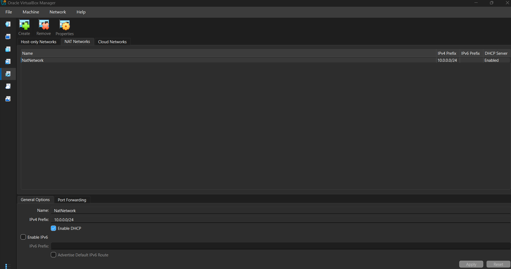
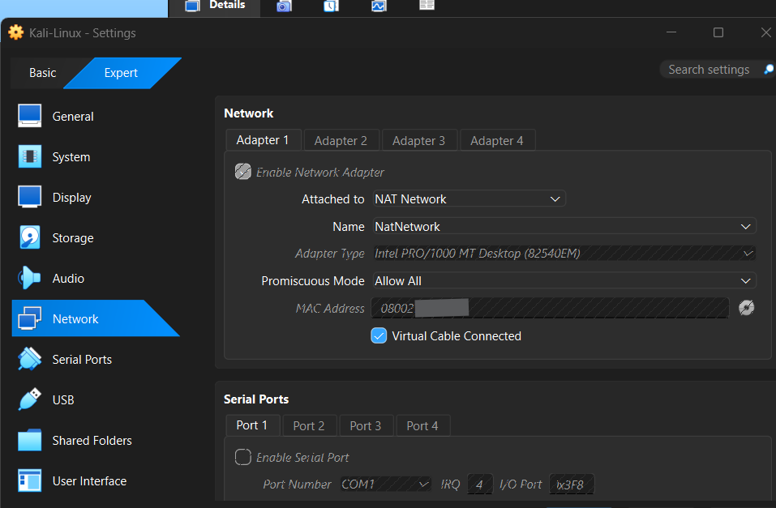
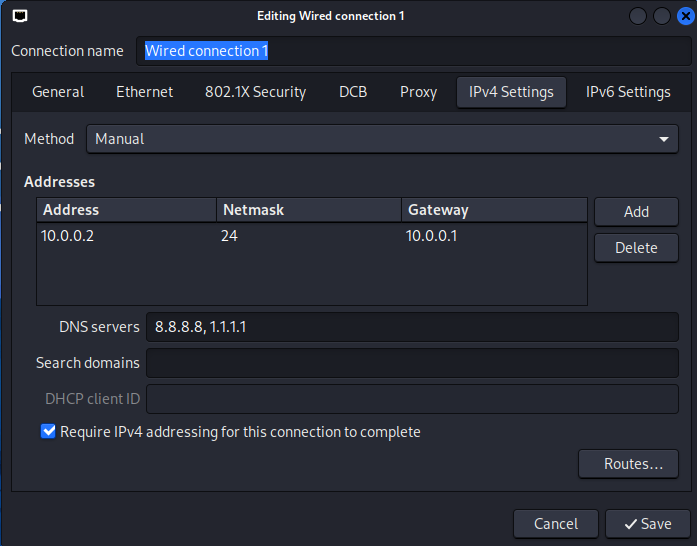
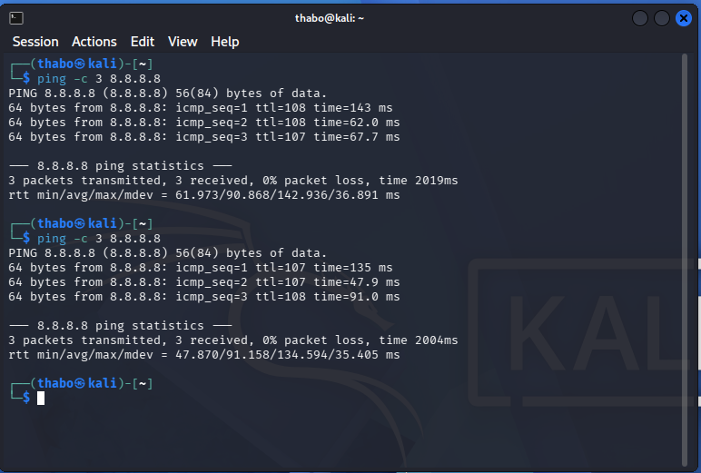
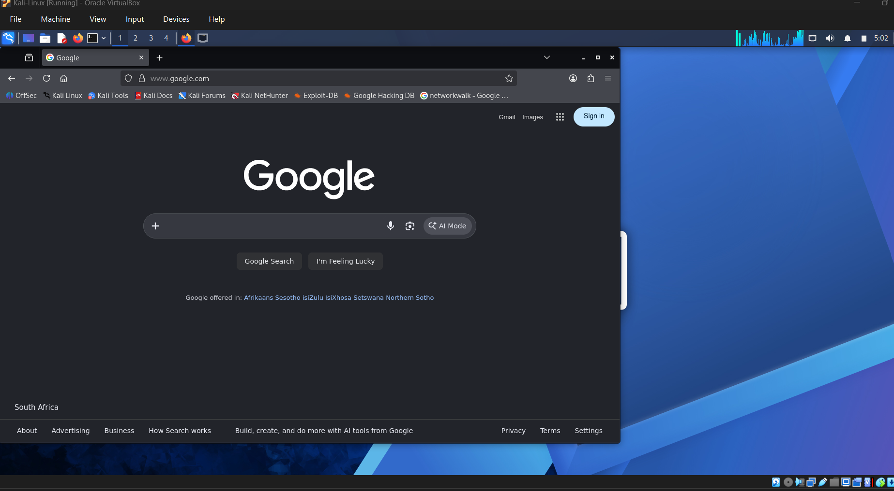

This lab documents how I managed to build  my home virtual lab using the VirtualBox and Kali linux with a custom NatNetwork.

## 1. Lab Goal
Create isolated cybersecurity Lab network with a network address of 10.0.0.0/24
- Gateway : 10.0.0.1
- Kali Linux PC : 10.0.0.2 as a static address
  
## 2. VirtualBox Setup
I have setup the NatNetwork on the VirtualBox with the DHCP Server enabled to allow automatic IP assignment for devices that will be added in future :

## 3. Kali linux Setup
After installing Kali linux i chose the GUI interface and changed it network settings on virtualBox to NatNetwork.
In an expect mode when choosing the NatNetwork this shows below:

## 4. Kali Linux Network Setup

I prompted the commands on the terminal to add the IP addresses
- sudo nmcli con mod "Wired connection 1" ipv4.addresses 10.0.0.2/24 ipv4.gateway 10.0.0.1 ipv4.dns "8.8.8.8,1.1.1.1"
- sudo nmcli con down "Wired connection 1"
- sudo nmcli con up "Wired connection 1"

This is the output of the addresses added:

Then the network restarted
## 5. Network Testing
To verify the network ip addresses i also prompted:
-ip a (Ip address)
-ip r  (gateway)

I Ping the google network connectivity:
-Ping -c 3 8.8.8.8
-ping -c 3 google.com

Connection was successful

## Key Tasks completed

- installed 7-Zip
- installed and configured VirtualBox
- Created and setup NatNetwork in VirtualBox
- Configured IP address
- Configured Network connectivity
- Tested internet connectivity

